# EXAMPLE-06 — Choose an SLA calendar by issue priority

This example shows how one SLA can use different calendars for different
issue priorities, without adding a setting or screen to Redmine.

## Why use this configuration?

Before 3.6.0, a level could be selected even when it had no term for the
issue's priority. Starting with 3.6.0, only levels with at least one matching
priority term are candidates.

Here we make the terms determine which levels are eligible:

| Redmine priority | Eligible level | Calendar |
| --- | --- | --- |
| Immediate, High or Urgent | Critical | 24x7 |
| Low or Normal | Standard | Monday to Friday, 09:00–17:00 |

This example uses Redmine's built-in issue priorities. The custom-field option
is described at the end. Redmine's default **Immediate** priority must also
be covered: this example includes it in the **Critical** level.

## Before you start

You need permission to manage SLAs and a project with an issue tracker enabled.
The example uses the **Production Incident** tracker, the built-in priorities,
and two SLA types:

- **Response time**, counted while an issue is New.
- **Resolution deadline**, counted while an issue is New or Assigned.

If these SLA types or statuses already exist in your installation, reuse them
instead of creating duplicates.

## Step 1 — Create one SLA

Go to **Administration → SLA Global settings → Service Level Agreements** and
create **SLA Priority calendars**.

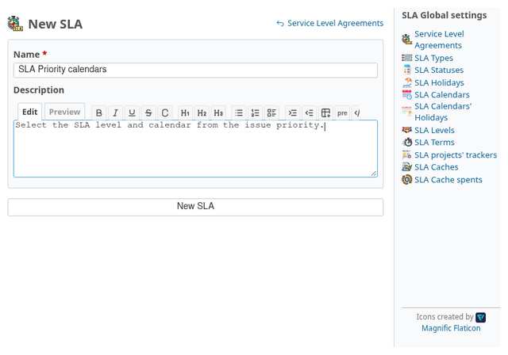

Fill in the name and save. Redmine should return to the SLA list.

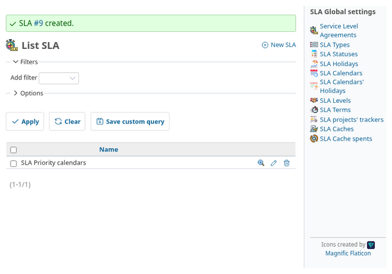

Confirm **SLA Priority calendars** appears in the list. This SLA will group
both priority-based levels.

## Step 2 — Define what is measured

Under **SLA Types**, create **Response time** and **Resolution deadline**.

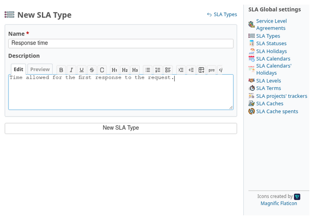

Save **Response time**. The next screen confirms it was added.

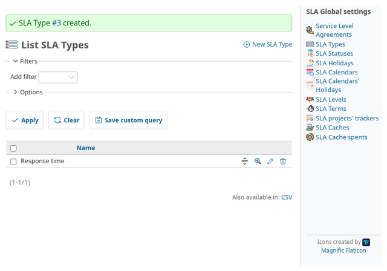

Now create **Resolution deadline** as a second type.

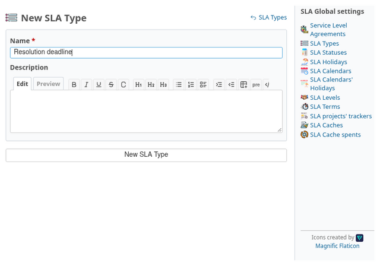

Save it and confirm both types are available.

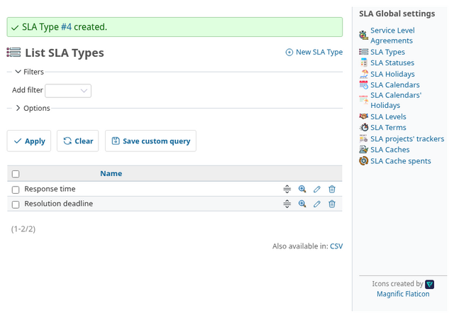

Under **SLA Statuses**, select the statuses in which each type counts:

- Response time: **New**
- Resolution deadline: **New** and **Assigned**

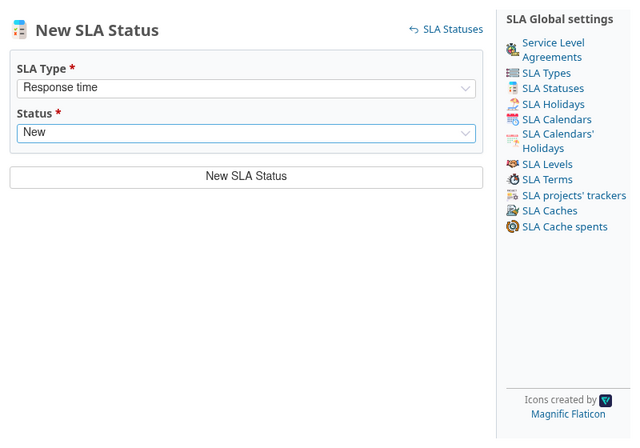

Save **New** for **Response time**. Confirm that rule was added before moving
to the resolution rules.

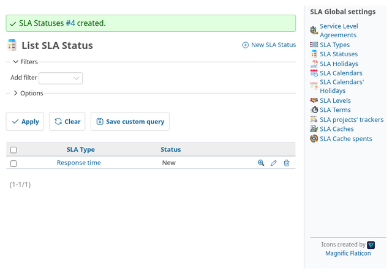

For **Resolution deadline**, first add the **New** status.

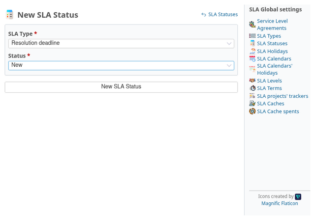

Save **New**. The list now shows the first resolution rule.

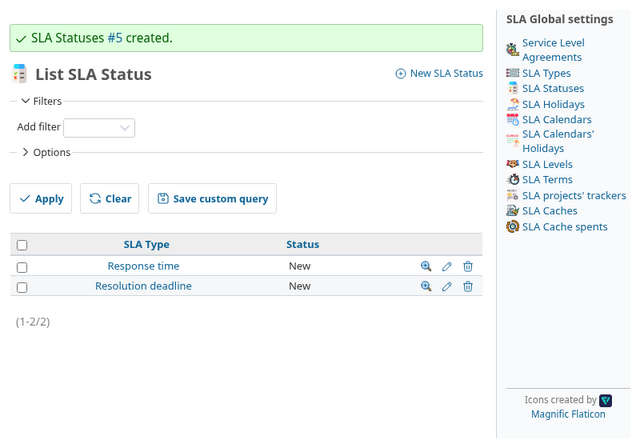

Add **Assigned** as the second status for **Resolution deadline**.

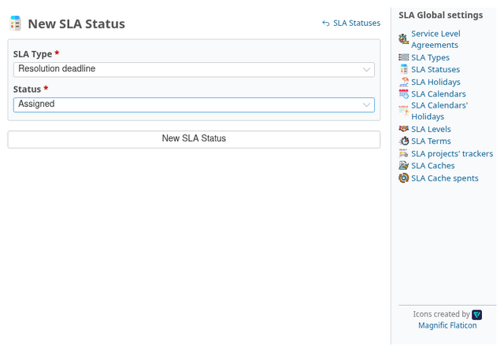

Save it and confirm that both **New** and **Assigned** are listed.

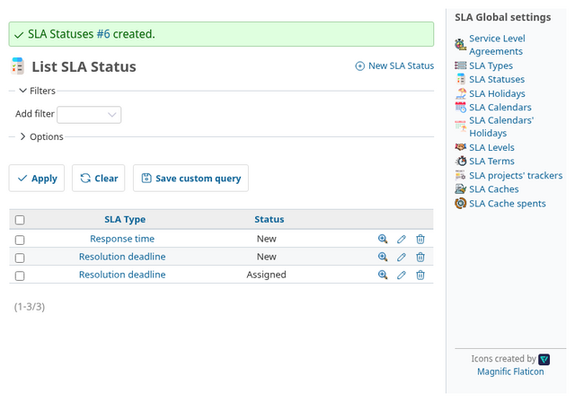

Statuses control when time is counted. Calendars, configured in the next step,
control which working minutes are available.

## Step 3 — Create the two calendars

Under **SLA Calendars**, create:

1. **24x7**: add a matching schedule from 00:00 to 23:59 for every day.
2. **Business hours**: add a matching schedule from 09:00 to 17:00, Monday
   through Friday. Leave weekends without a schedule.

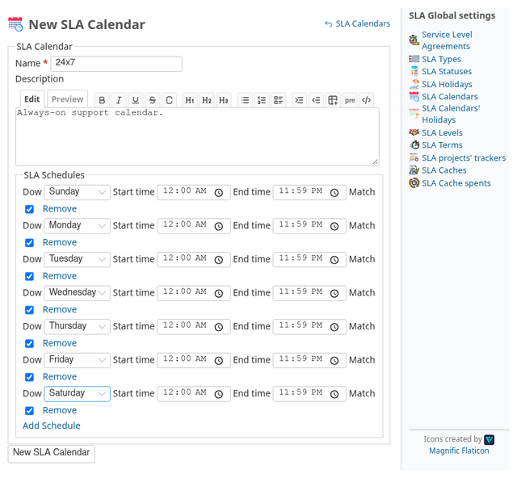

Save the 24x7 schedule. The calendar should now be available for the Critical
level.

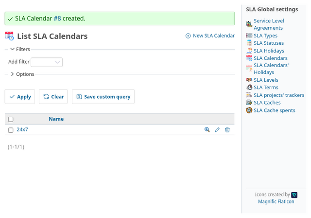

Next, create the business-hours calendar with weekdays only.

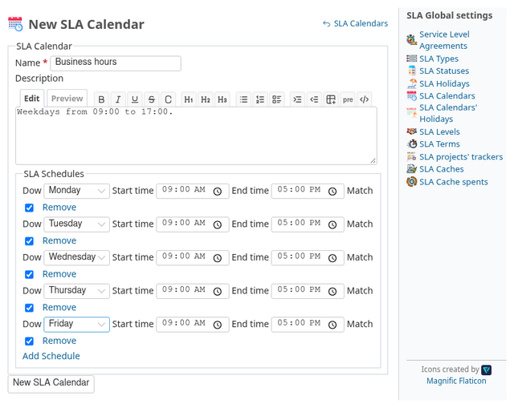

Save the calendar and check its weekday schedule.

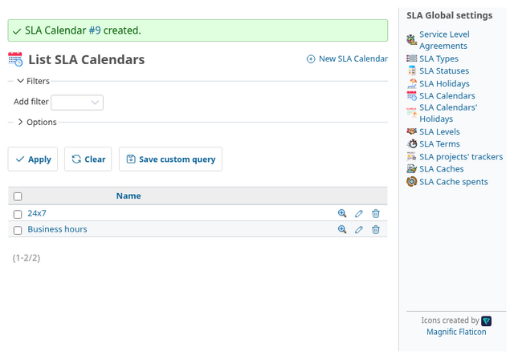

No holidays are needed for this simplified example. Add the holidays that
apply to your service in a real configuration.

## Step 4 — Create one level per priority group

Under **SLA Levels**, create both levels under **SLA Priority calendars**:

1. **Critical**, using the **24x7** calendar. Leave the custom priority field
   empty so the level uses Redmine's native priority. It covers **Immediate**,
   **Urgent**, and **High**.
2. **Standard**, using the **Business hours** calendar. Leave the custom
   priority field empty here too.

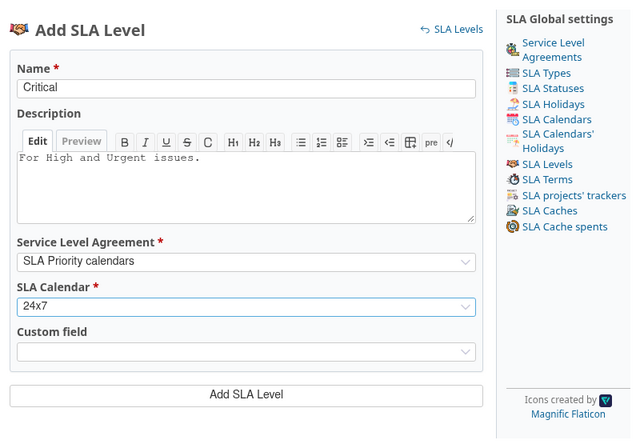

Save **Critical** with the 24x7 calendar and confirm it appears in the level
list. Then start the second level.

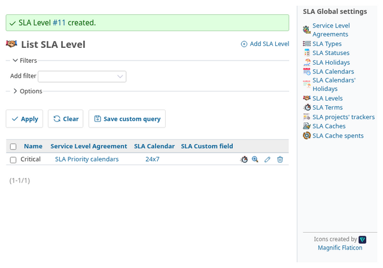

Now create **Standard**, using the business-hours calendar.

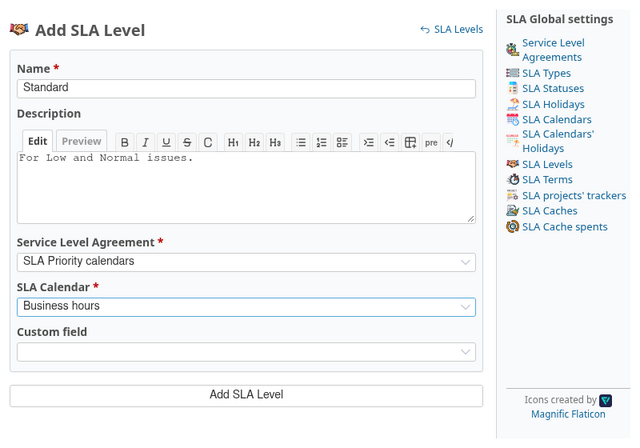

Save **Standard** with the Business hours calendar. Confirm both levels appear
under **SLA Priority calendars**.

The levels belong to the same SLA. Their calendars differ; the terms entered
in the next step make them eligible for different priorities.

## Step 5 — Enter terms for each level

Open the terms for **Critical** and enter terms for **Immediate**, **Urgent**,
and **High**.
Then open **Standard** and enter terms for **Low** and **Normal**. Do this for
each SLA type:

| Level | Priority | Response time | Resolution deadline |
| --- | --- | ---: | ---: |
| Critical | Immediate | 5 minutes | 1 hour |
| Critical | High | 15 minutes | 4 hours |
| Critical | Urgent | 10 minutes | 2 hours |
| Standard | Normal | 1 hour | 8 hours |
| Standard | Low | 2 hours | 16 hours |

The numbers are example targets; use the values in your own service contract.

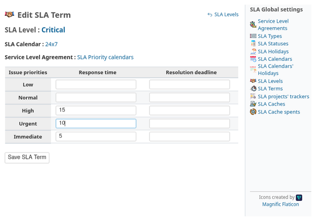

Enter the three Critical response targets. Save them and verify they are
stored before entering the resolution targets.

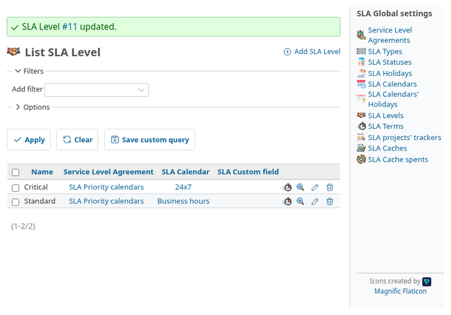

With the Critical response targets saved, select **Resolution deadline** and
enter its targets.

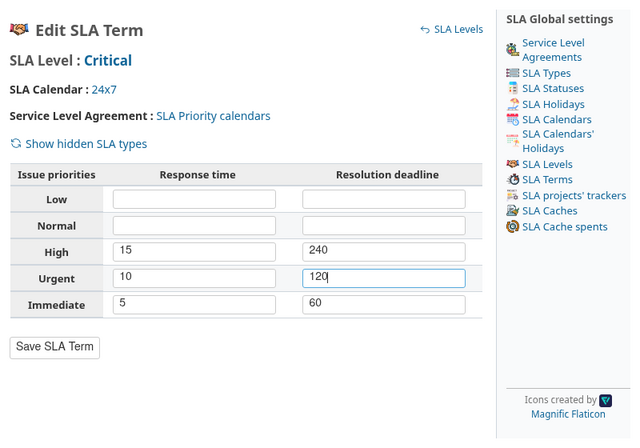

Save the Critical resolution targets. Then move on to the Standard response
targets.

Critical now has both target types. Next, define Standard's response targets.

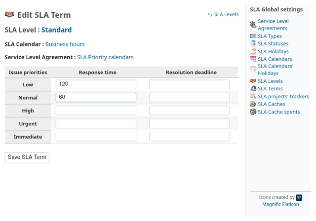

Save the Low and Normal response targets for **Standard** before entering its
resolution targets.

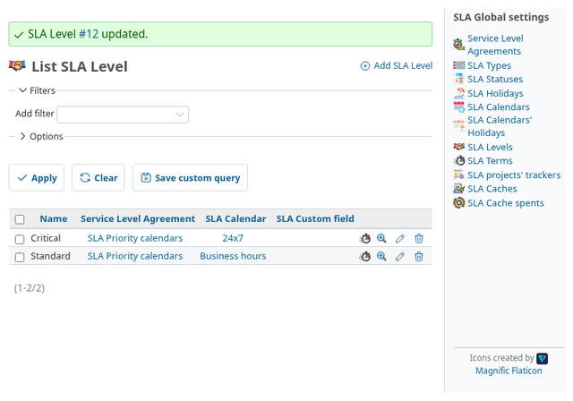

Open the Standard resolution terms and enter both targets.

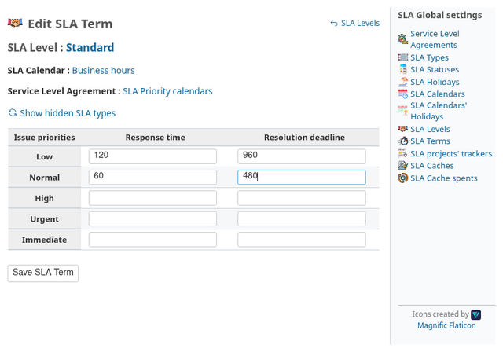

Save them and confirm the final terms are listed.

**Why must the terms be entered this way?** A level is eligible when it has at
least one term for the issue's priority, regardless of SLA type. The selected
level's calendar is used for the calculation, while each displayed SLA type
uses its own matching term. Therefore, add the relevant priorities to every
type you expect the level to display.

## Step 6 — Map the SLA to the project and tracker

Enable the SLA module in the project, enable the **Production Incident**
tracker, then open **Project → Settings → SLA**. Map that tracker to **SLA
Priority calendars**.

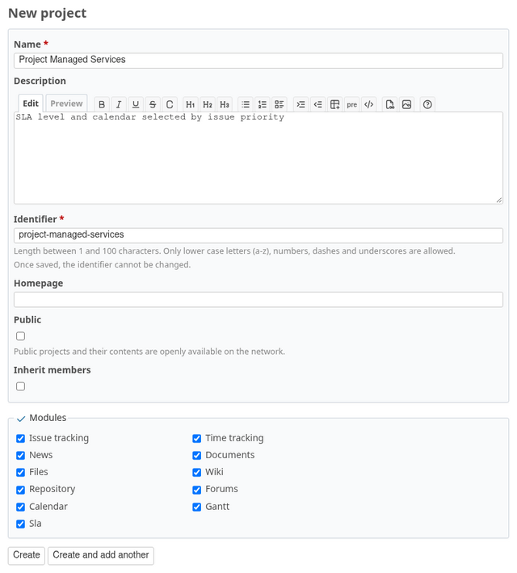

Create the project with the SLA module enabled. Confirm the project page opens
before configuring its tracker.

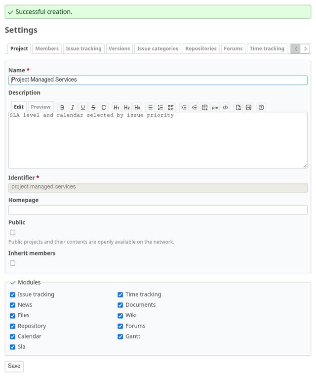

Open the project's issue settings and enable **Production Incident**.

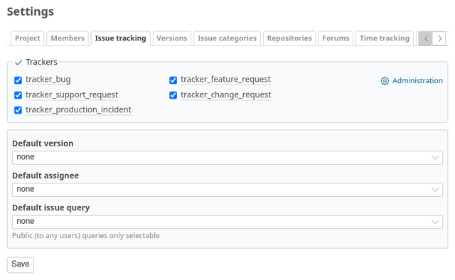

Save the tracker selection and confirm it remains enabled.

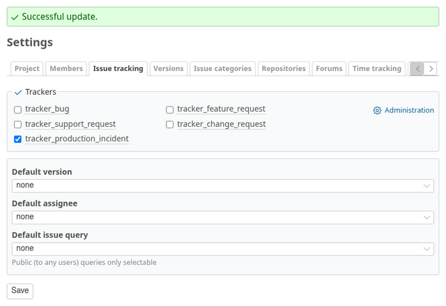

Open the project's SLA settings.

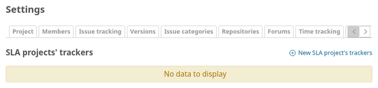

Add a mapping for **Production Incident** to **SLA Priority calendars**.

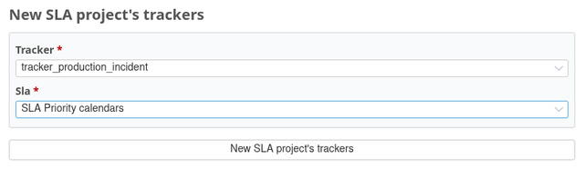

Save the mapping and confirm it appears in the project SLA list.

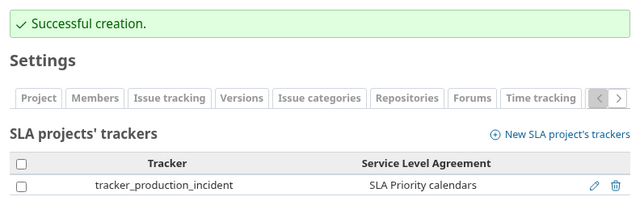

The mapping chooses the SLA. The issue priority then determines which of that
SLA's levels are candidates.

## Step 7 — Check the result on issues

The documentation test creates each issue at 22:00 on the previous weekday
and captures the screens at test runtime:

- An **Urgent** issue is assigned to **Critical**. Its 24x7 calendar can start
  the SLA immediately, so its clock has been running overnight.
- A **Normal** issue is assigned to **Standard**. Its SLA starts at the next
  weekday opening time, 09:00.

It asserts the selected level before capturing the issue and **Explain**
screens, so this example also checks the configured behavior end to end.

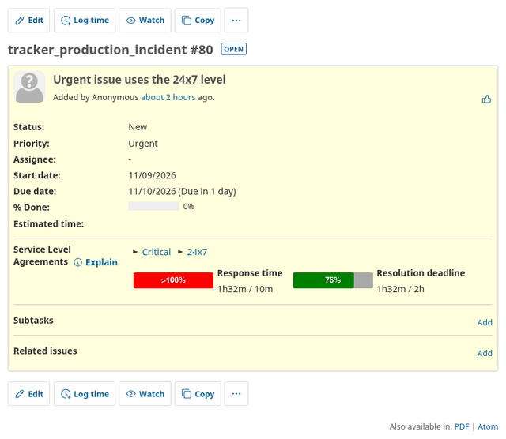

Check that the issue page names **Critical** and its 24x7 calendar.

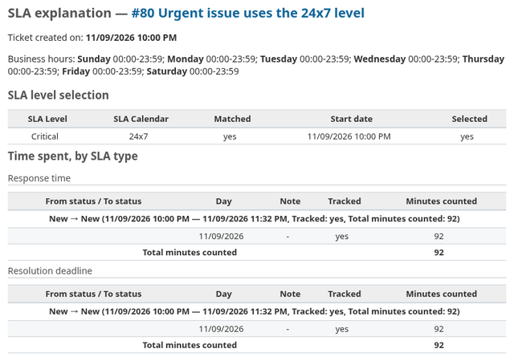

In the explanation, confirm **Critical** is the selected eligible level.

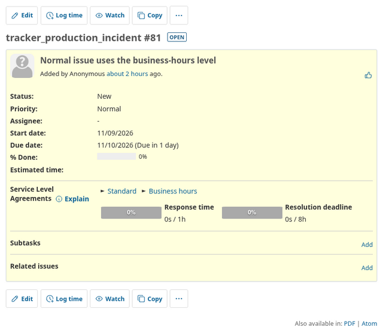

The Normal issue should instead show **Standard** and its Business hours
calendar.

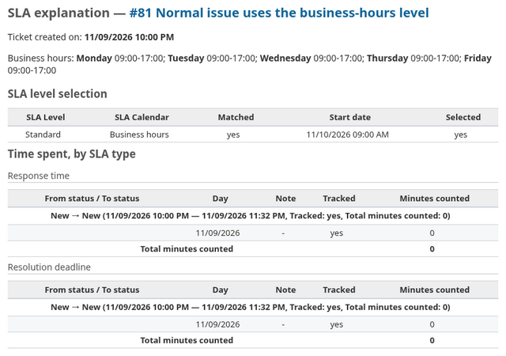

Confirm **Standard** is selected in its explanation as well.

If no level in the mapped SLA has a term for an issue's priority, that issue
has no SLA level or cache. In particular, if you remove **Immediate** from
**Critical**, Immediate issues will have no SLA. Make sure each priority that
should be covered has terms on the intended level.

When an issue's priority changes, the new level and calendar are applied from
the issue's creation time. Time is not split between the previous and new
calendars. For example, changing a Normal issue to Urgent can make it already
overdue under the Urgent target, because that target is evaluated from the
issue's original creation time.

If two levels have terms for the same priority, both are eligible. The
calendar with the earliest matching start wins; if their starts tie, the
lower level id wins. This lets you combine priority-based calendars with
working-hours/non-working-hours levels. See [the calculation rules](COMPUTE.md#sla-calendars).

## Using a custom field instead

If your SLA priority is different from Redmine's native priority, configure an
eligible issue custom field on each relevant level. Create an enumeration
custom field and use its values as the level's terms.

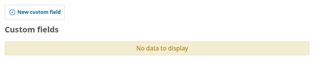

The terms for that level must use the custom field's enumeration values. The
priority source is selected per level, so a single SLA can also combine
native-priority and custom-field levels.
