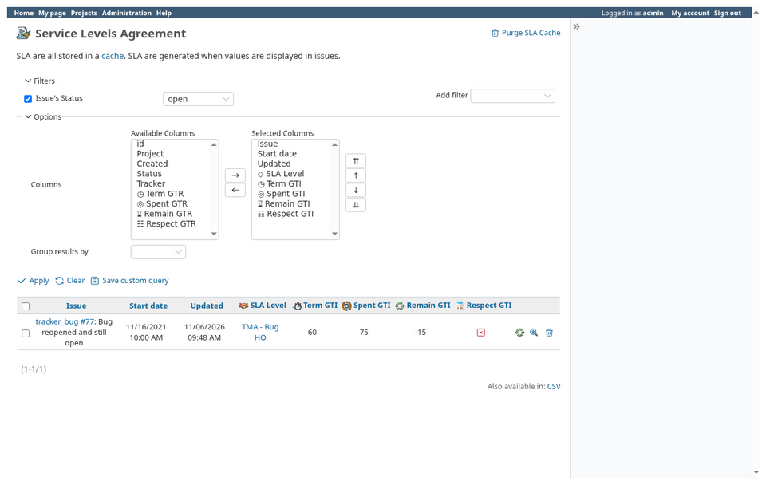
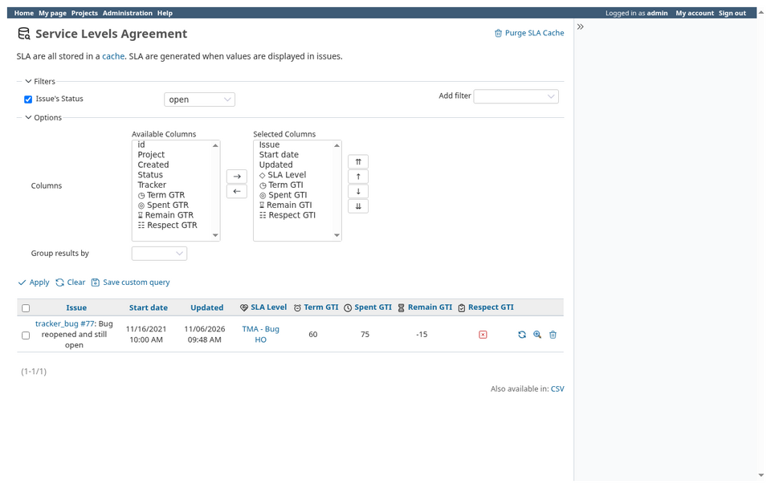

# Icon sets

Select **Flaticon / Magnific** (default) or **Tabler Icons** in the plugin's
**Display** settings. The choice applies to SLA views, column headers,
administration and project markers. Standard actions retain Redmine's icons.





## Add a set

Create `assets/images/icon_sets/<id>/` with a `manifest.yml` and its images,
then restart Redmine. The set appears in the same selector as the bundled sets.
Use their manifests as examples. Back up custom directories before updating.
Invalid YAML or manifest declarations are ignored with a warning in Redmine's
log. File sizes must be positive integers (`16:` and `"16":` are both accepted);
duplicate sizes are rejected. Missing roles use Tabler's fallback icons.

| Manifest field | Content |
| --- | --- |
| `name` | Display name |
| `format` | `files` or `svg_sprite` |
| `icons` | SLA roles mapped to size/file pairs or sprite symbol IDs |
| `file` | Sprite filename, for `svg_sprite` |
| `credit.display` | `true` to show attribution; `false` to hide it |
| `credit.text` / `text_key` | Literal credit text or translation key |
| `credit.logo`, `author`, `source` | Optional logo and named links |

Paths are relative to the set's directory. Copy the role names from an existing
manifest; menus and project markers use `sla`. No set-specific CSS is needed.
Only local sets inside the plugin directory are supported.

Credits appear at the bottom of the SLA sidebar, outside plugin settings.
Keep license files with the images even when interface credits are hidden.

## Rendering

```ruby
sla_icon('sla_level', context: :heading, plugin: 'redmine_sla')
```

`IconSet` resolves assets and fallbacks; helpers render their HTML, and native
view adaptations live in `patches/`.

Contexts use 16px for menus/lists/columns, 20px for forms and 24px for headings;
`size:` overrides them. Administration menus follow Redmine’s native size.
File sets select the nearest suitable size. SVG sprites
have explicit dimensions and strokes, including on Redmine 5. Column captions
remain plain text in exports. Column selectors use `◇` for level, `◎` for spent time, `◷` for terms,
`⌛︎` for remaining time and `☷` for respect. HTML headers keep the selected set’s
icons independently of these text markers.

## Checks

Run `test/standalone/icon_set_test.rb` and `sla_icons_helper_test.rb` (the latter
requires ActionView and Nokogiri). Before release, also verify both sets in the
browser on each supported Redmine version, including sorting, actions, credits
and deployments under a URL prefix.
