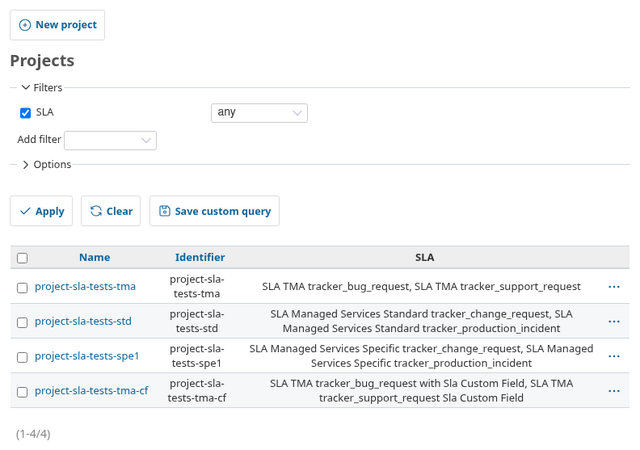
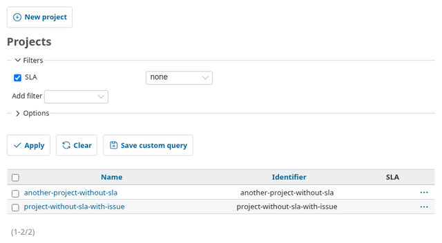
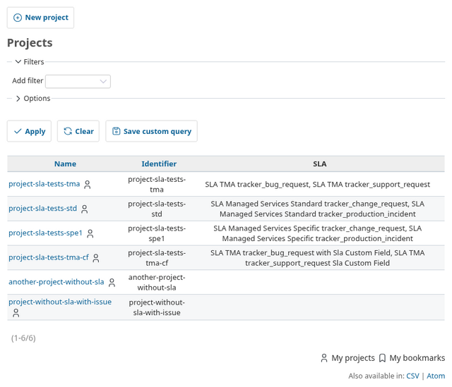
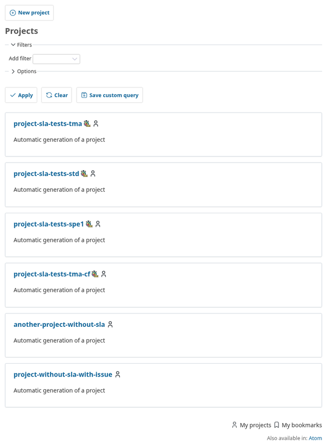
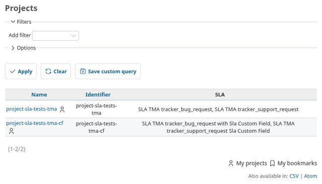
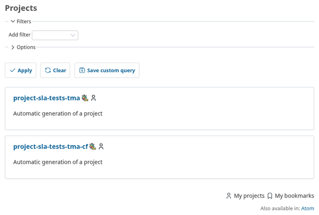
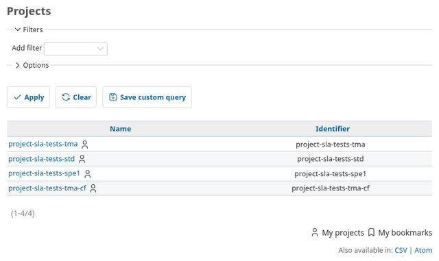
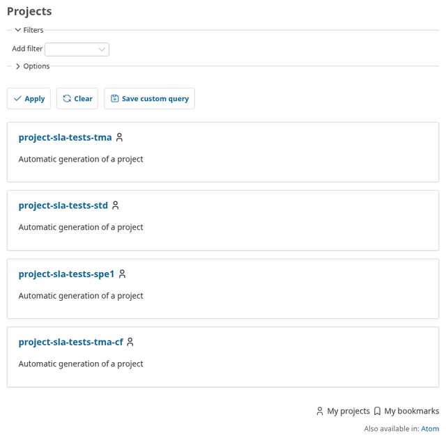

# Projects with SLA

The project lists show which projects have SLAs assigned (through the SLA
project trackers):

-   **Administration > Projects** and **Projects** in list mode: an
    **SLA** column listing the SLAs of each project, and an **SLA** filter
    (any, none, is, is not).
-   **Projects** in board mode: an SLA icon after the name of each
    project with SLAs.

The detailed project / tracker / SLA assignments remain available in
**Administration > SLA Global settings > SLA projects' trackers** (group
the list by project).

## Who sees what

| Profile | Column and filter offered | SLAs shown for |
| --- | --- | --- |
| Administrator | yes | every project, even with the SLA module disabled |
| *View SLA* or *Manage SLA* in at least one project | yes | projects where the user has one of these permissions and the SLA module is enabled |
| No SLA permission (or anonymous) | no | none |

A project whose SLAs the user may not see behaves as a project without
SLA: no value in the column, no icon, and it matches the "none" filter.
The filter values only list SLAs assigned to projects the user may see.

## Screenshots

Screenshots are taken on the test fixtures: projects 1 to 4 have SLAs,
`another-project-without-sla` and `project-without-sla-with-issue` have none.

### Administrator

Administration > Projects, filter **SLA: any**:



Filter **SLA: none**:



### Manager (View SLA and Manage SLA in every project)





### Developer (View SLA in two projects)





### Reporter (member without SLA permission)

No SLA column is offered and no icon is displayed.





## Regenerate the screenshots

The screenshots are produced by `test/documentation/sla_project_lists_doc_test.rb`,
which also checks in Chromium what each profile sees. It runs with the
documentation tests (see [Testing](TESTING.md)) or alone:

``` bash
bundle exec rails test plugins/redmine_sla/test/documentation/sla_project_lists_doc_test.rb
```

Images are written to `tmp/redmine_sla/screenshots/project-lists/`; copy
them to `doc/screenshots/project-lists/`.
