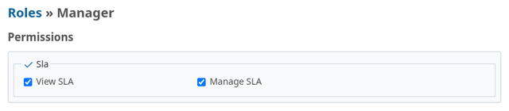
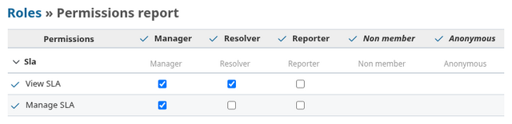

# Plugin settings

The plugin settings are accessible on `http://[redmine-host]/settings/plugin/redmine_sla`.

## Time zone

Globally change the timezone used in the calculation of SLAs.

Default: Etc/UTC

## Display

Allows you to choose between displaying the SLA as a bar or as a pie chart.

Default: bar - simple

## Default holiday country

Optional ISO country code (for example `FR`) preselected by the
[public holiday import](HOLIDAY_IMPORT.md). Leave blank to choose the
country at import time.

Default: blank

## Roles and permissions

SLA definitions (SLAs, types, statuses, holidays, calendars, levels and terms)
are global and can only be created, edited or deleted by Redmine
administrators, from `Administration → SLA Global settings`.

Project-level access is granted through roles. Go to
`Administration → Roles and permissions`, edit a role and, in the **SLA**
module, tick the permissions it needs:

| Permission | Grants |
|---|---|
| `view_sla` (View SLA) | SLA block on issues, SLA columns and filters in issue/time-entry lists, the project SLA menu, and read-only access to the project's SLAs, levels, calendars and caches |
| `manage_sla` (Manage SLA) | Tracker-to-SLA mappings in project settings and the Explain action. Cache refresh, deletion and project purge also require `view_sla`. |

Grant **both permissions** to project managers: `manage_sla` does not include
`view_sla`. Either permission grants access to the SLA column, filter and board
icon in the [project lists](PROJECT_LISTS.md). Only administrators may purge
caches across all projects.

For non-administrators, permissions apply to projects where:

- the **SLA** module is enabled (`Project → Settings → Modules`);
- the user is a member with a role carrying the permission.

Non-administrators with neither permission see no SLA information, even on
issues covered by an SLA.

Typical setup:

| Role | `view_sla` | `manage_sla` |
|---|:---:|:---:|
| Project manager | x | x |
| Developer / resolver | x | |
| Reporter / client | | |

The *Permissions report* (`Administration → Roles and permissions → Permissions report`)
gives the same overview for all roles:

